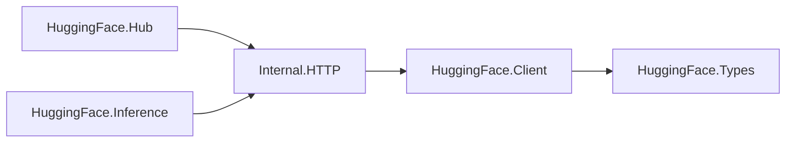

# Architecture

Derived from [architecture.yaml](architecture.yaml).

The public convenience module reexports the four public modules. The private
transport layer centralizes URL encoding, authentication, redirects, status
handling, and JSON decoding. An opaque client holds a reusable manager and
trusted origins. Tests exercise public operations through local HTTP servers.
